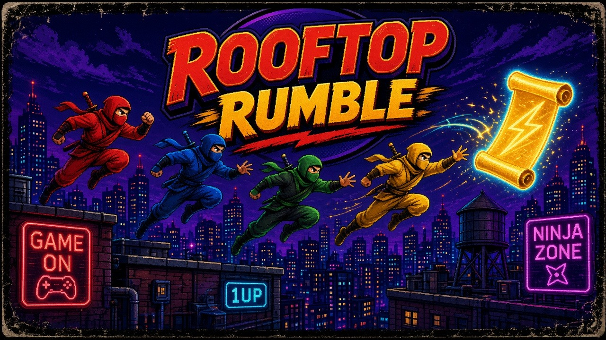

# Rooftop Rumble

Ninjas race across a moonlit city to steal and keep the scroll. It is a local four-player side-view rumble: jump the gaps, wall-jump the chimneys, and do not be the one who drops the prize into the street.

## Launch

The game is plain HTML, CSS, and JavaScript. A tiny Python server opens it in your browser. The default port is **8818**. If that port is taken, the server moves to the next free port.

| Platform | How |
| --- | --- |
| macOS | Double-click `launch-mac.command` |
| Windows | Double-click `launch-windows.bat` |
| Linux | `./launch-linux.sh` |
| From a terminal | `python3 server.py` |

Each launcher looks for Python 3 and prints a short install hint if it is missing. The page does not load libraries from the network, so it keeps running offline after it is open.

## Controls

Four players share one keyboard. A gamepad in slot 0–3 takes over that same player (left stick or D-pad to move, **A** jump, **B** strike, **Start** pause) and leaves the keyboard bindings for everyone else. Unplug the pad and the keyboard mapping comes back.

Up also jumps. Down plus strike throws a shuriken if you are carrying any. **M** mutes. **Esc** pauses.

| Player | Move | Jump | Strike |
| --- | --- | --- | --- |
| Crimson (P1) | W A S D | F | G |
| Azure (P2) | Arrow keys | / | . |
| Verdant (P3) | I J K L | ; | ' |
| Amber (P4) | Numpad 8 4 5 6 | Numpad 0 | Numpad Enter |

On the join screen, press your jump key to claim a slot. Secondary toggles an empty slot between **Bot** and **Off**. Enter starts the match. Any slot you leave empty can be a bot, so one person can play against the rooftops.

Pause opens settings for volume and how many rounds win the match (1–5, default 3), plus a remap screen. Bindings and settings are stored in `localStorage`.

## Rules

- One scroll appears on a random roof. Carry it to score **1 point per second**.
- The holder moves **10% slower** and cannot dash-strike.
- A strike (or a shuriken) on the holder drops the scroll. It bounces loose.
- Shuriken pickups grant **3** throws. Down + strike throws one. A hit knocks the target back.
- Fall into the street and you are out for **2 seconds**, then you respawn on a rooftop. The scroll does not come with you.
- A round ends when someone reaches **60** points, or when **150 seconds** run out and the highest score wins. A tie at the buzzer goes to overtime until somebody leads.
- First to **3** rounds wins the match (change this in settings). Then rematch or return to the title.

The shared camera zooms out to keep every ninja still in the fight on screen.

## Arcade manifest

`arcade.json` describes the cabinet entry: name, id `rooftoprumble`, cover, icon, four players, keyboard and gamepad, port 8818, and the one-click launchers plus `index.html`.

## Tests

```bash
node --test tests/
python3 tests/server_smoke.py
```

Node's built-in test runner covers movement and collision, scoring, round and match wins, elimination and respawn, shuriken, seeded randomness, keyboard and gamepad mapping, and `arcade.json`. The Python smoke test starts `server.py` and checks that it serves the page. GitHub Actions runs both.

## License

MIT. See [LICENSE](LICENSE).
